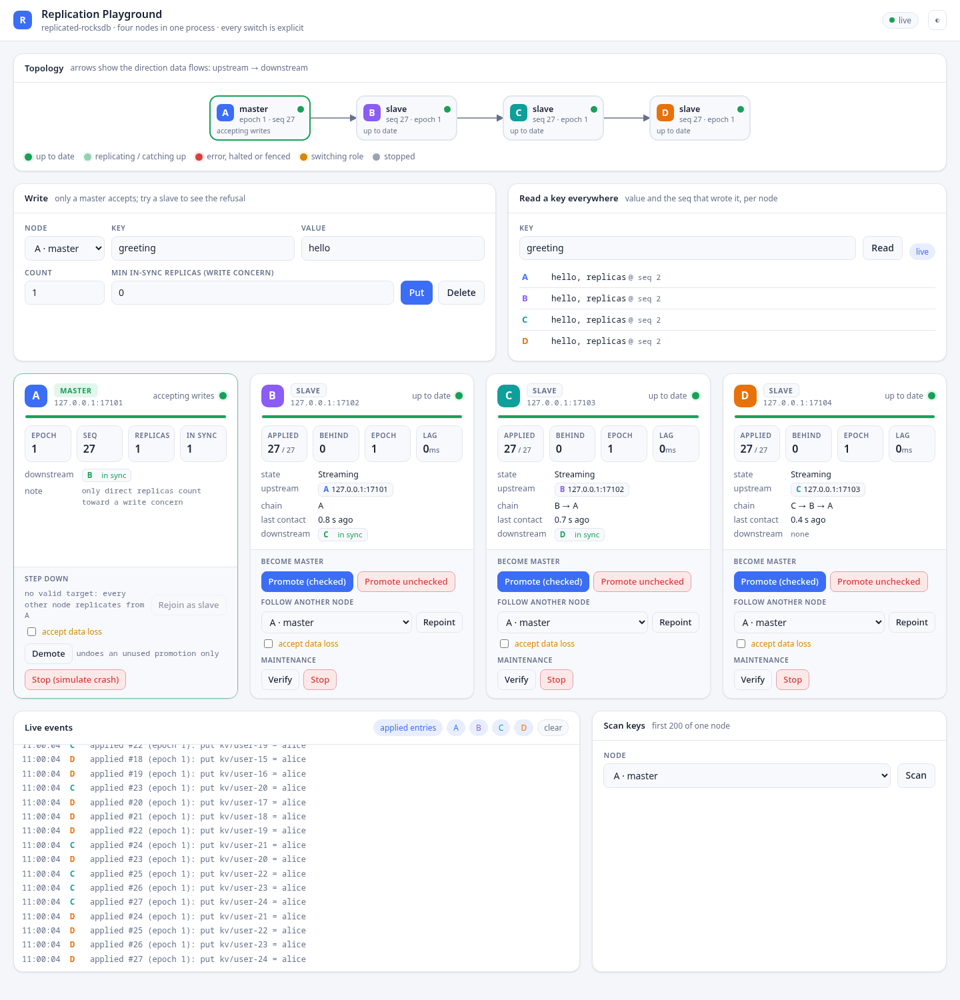
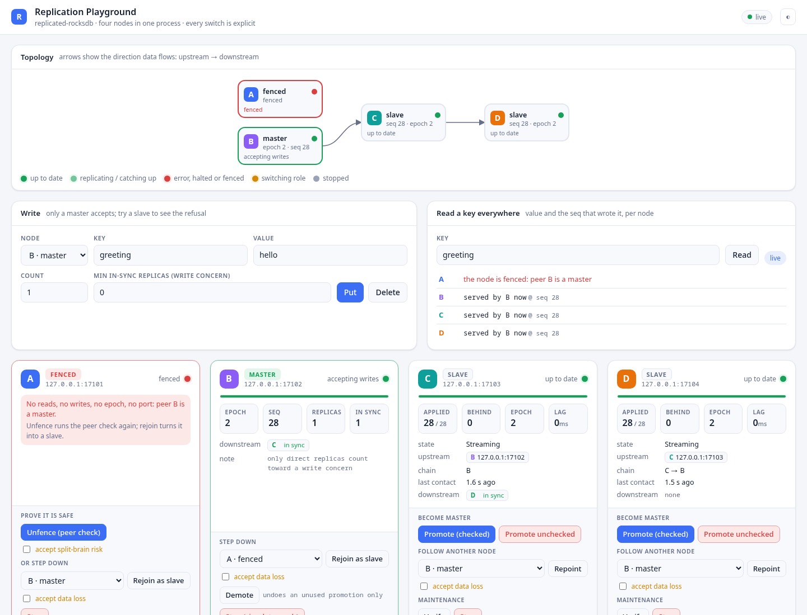
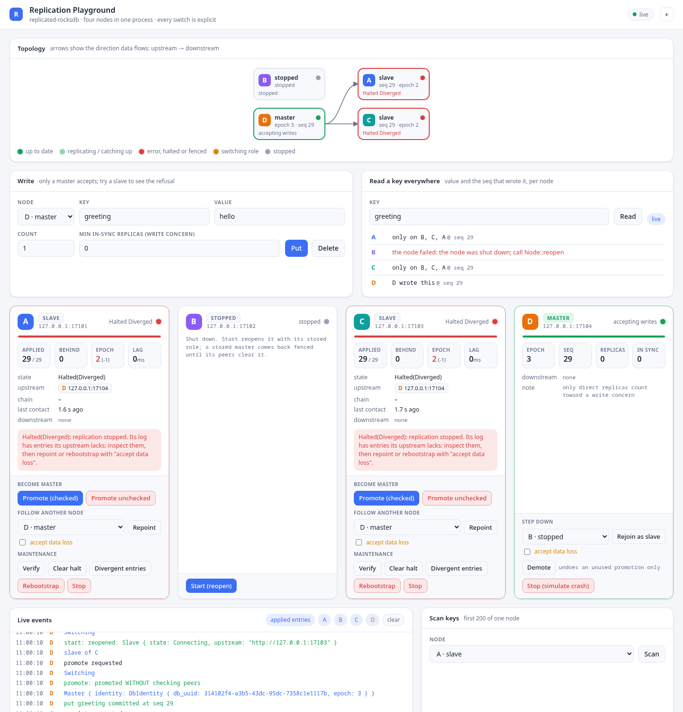
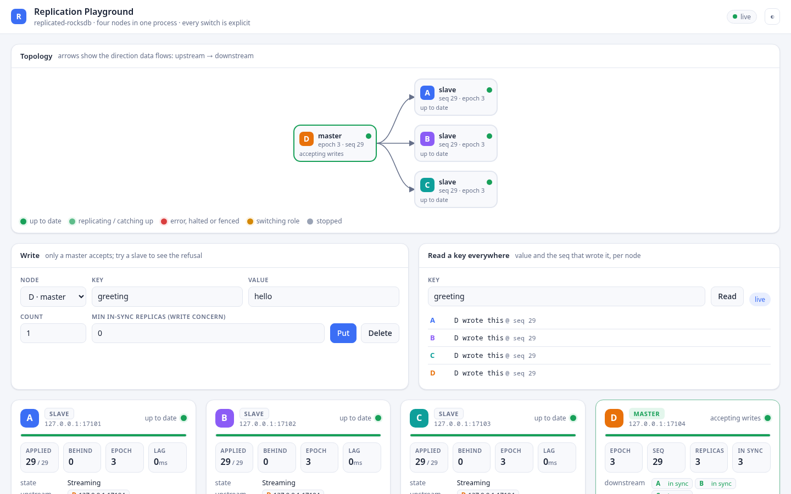

# replicated-rocksdb

Single-master, asynchronous log-shipping replication for [RocksDB](https://rocksdb.org/),
as an embeddable Rust crate.

One process opens the **master**, the only writer. Every write becomes one fsynced,
checksummed log entry of absolute operations. Any number of read-only **slaves** replay that
log in order, directly from the master or chained through other slaves. Replicas end up
byte-identical to the master at the same sequence number, and any disagreement in history is
detected and halts replication instead of being silently papered over.

```
Master(A) ──► Slave(B) ──► Slave(C)
                 └──────► Slave(D)
```

## Why use it

- **Embedded, not a server.** No separate database process, no cluster to operate. Your
  application links the crate, opens its local RocksDB through it, and reads in-process at
  RocksDB speed. The network port is used only for replication.
- **Replicas you can trust.** Same logical data and the same physical values (including
  metadata) at the same seq. Every entry is CRC-chained to its predecessor, and replicas can
  verify themselves against their upstream on demand.
- **Divergence is never silent.** A replica that is ahead of, or forked from, its upstream
  halts with a precise reason. Nothing that could lose data happens unless you call an
  explicit API and pass a typed consent token (`AcceptDataLoss`, `AcceptSplitBrainRisk`).
- **Simple, predictable model.** Only absolute operations (`Put`, `Delete`, `DeleteRange`,
  `CreateCf`, `DropCf`) are logged, so replay is deterministic and idempotent to reason
  about. No consensus protocol, no hidden leader election.
- **Durable by construction.** The mutation, its log entry and the position marker commit in
  one RocksDB `WriteBatch`, on the master and on every replica. A crash never leaves a
  half-applied entry, and replicas resume from their own durable position.
- **Operator-friendly failover.** Promotion is manual and checked: the crate tells you which
  replica is the safest candidate, refuses a promotion that would lose acknowledged data, and
  fences a restarted old master so you never end up with two writers by accident.

## Features

- **Master / slave roles** persisted on disk; opening a directory in the wrong role is refused.
- **`Node` handle** (`Arc<Node>`): one object that holds either role and switches explicitly
  (`promote_checked`, `demote`, `rejoin_as_slave`, `unfence`), with an exact `state()` /
  `watch_state()` API. Callers keep their reference across role changes.
- **Fenced restart of a former master**: a stored master reopened through `Node` takes no
  reads or writes until its peers confirm no other master exists and nobody is ahead.
- **Rejoin**: a former master becomes a replica of the new one without wiping its directory;
  it resumes if its log is a prefix, and halts `DIVERGED` otherwise.
- **Chained replication**: any slave can serve other slaves (fan-out trees, cross-region relays),
  with loop detection. Entries are forwarded verbatim; identity always refers to the origin master.
- **Automatic bootstrap**: a new or far-behind replica pulls a consistent RocksDB snapshot,
  then tails the log from that exact point. Retention is guarded while a bootstrap is running.
- **Real-time or batched fetch**: entries stream as soon as they commit, or in batches for
  bandwidth efficiency (`FetchConfig`).
- **Write concern**: optionally make writes wait for acknowledgement from N in-sync replicas
  (`WriteConcern`), with Kafka-like `NotEnoughReplicas` / `AckTimeout` semantics.
- **Read-your-writes on replicas**: `wait_for_seq(seq)` blocks until a replica has applied a write.
- **Column families** created and dropped through the log, with custom comparators via a registry.
- **Master-driven TTL**: per-value expiry computed on the master, filtered on every read, and
  reaped by the master as logged deletes, so all nodes agree.
- **Bounded changelog** on every node (time and/or count based retention).
- **Integrity verification**: `verify_now` in `Quick` (value headers) or `Full` (full values) mode, with
  optional automatic repair of mismatches.
- **Repair and repoint**: move a replica to a new upstream; resume when histories agree,
  rewind and replay (with explicit consent) when they diverged; list the divergent entries
  first so you can salvage them.
- **Epoch history and identity**: every master incarnation starts a new epoch with a fresh
  nonce; promotions extend the history, so forks are always detectable.
- **Security**: TLS (rustls), mTLS subject allow-lists, bearer tokens, per-method authorization
  (`Authenticator`), all pluggable.
- **Observability**: `tracing` spans, `Slave::status`, `Master::replicas`, a `Status` RPC,
  optional JSON status and Prometheus metrics over HTTP on the replication port, and a `ReplicationListener` callback for applied entries, bootstraps, state changes and
  verify results (handy for maintaining derived indexes or caches).
- **Normative wire protocol**: gRPC (tonic + prost), specified in [PROTOCOL.md](PROTOCOL.md)
  with test vectors.

## Typical use cases

- **Read scale-out for read-heavy services.** One writer, many local read replicas next to
  the API servers that need them; reads never leave the process.
- **Configuration, catalog and reference data.** Feature flags, routing tables, product
  catalogs, permission sets: low write rate, many readers, every node must see the same data.
- **Edge and multi-region caches with a single source of truth.** Chain replicas through a
  regional relay to keep WAN traffic to one stream per region.
- **Warm standby / disaster recovery.** Keep a replica (with write concern if you need zero
  loss of acknowledged writes) and promote it with a checked, auditable runbook.
- **Embedded state for a stateful service.** Give a single-leader service (scheduler,
  coordinator, metadata store) a durable, replicated local store without running an external
  database.
- **Change data feed.** Use `ReplicationListener::on_entry` on a replica to drive search
  indexes, caches or audit logs from the ordered, checksummed log.

## When not to use it

- You need multiple writers, consensus, or automatic leader election: use a Raft-based store.
- You need high write throughput across many writers: the design targets **low update
  frequency**, every master write is fsynced.
- You need read-modify-write primitives (CAS, merge, counters) in the database: there are none
  by design. Hold your own lock around `get` → compute → `put` (see the crate docs).
- You need a network query API: applications read in-process only.

## Quick start

```rust
use std::net::{IpAddr, Ipv4Addr};
use std::sync::Arc;
use replicated_rocksdb::{
    AllowAll, CfSpec, Master, MasterConfig, ReadApi, ServeConfig, Slave, SlaveConfig,
    UpstreamConfig,
};

#[tokio::main]
async fn main() -> Result<(), Box<dyn std::error::Error>> {
    // Master: the only writer, serving replication on a local port.
    let mut mcfg = MasterConfig::new("master-1", "/var/lib/app/master");
    mcfg.serve = Some(ServeConfig::new(IpAddr::V4(Ipv4Addr::LOCALHOST), 7000, Arc::new(AllowAll)));
    let master = Master::open(mcfg).await?;

    master.create_cf(CfSpec::new("users"))?;
    let seq = master.put("users", b"alice", b"Alice A.")?;

    // Slave: point it at the master; it bootstraps, then tails the log.
    let scfg = SlaveConfig::new(
        "replica-1",
        "/var/lib/app/replica",
        UpstreamConfig::from_addr(master.serve_addr().unwrap()),
    );
    let slave = Slave::open(scfg).await?;
    slave.wait_for_seq(seq, std::time::Duration::from_secs(10)).await?;
    assert!(slave.get("users", b"alice")?.is_some());
    Ok(())
}
```

`AllowAll` disables authentication; see the `secure_replication` example for TLS and tokens.
Optional zstd compression of replication traffic is `ServeConfig::compression` /
`UpstreamConfig::compression` (`WireCompression`, off by default). Every node accepts zstd, but
upgrade all nodes before enabling it on any: gRPC does not negotiate request compression.
More runnable programs are listed in [examples/README.md](examples/README.md)
(`cargo run --example <name>`).

## Playground

The quickest way to get a feel for the model is the interactive web playground:

```sh
cargo run --example playground          # then open http://127.0.0.1:8080
```

It runs four `Node`s in one process as a daisy chain **A → B → C → D**. From the browser you
write on the master, read a key on every node side by side, and drive every role transition by
hand, while each node's state is pushed live over a WebSocket (fed by the slaves'
`ReplicationListener` and each `Node::watch_state`).



**What each card shows.** A status light (green: up to date, blinking: replicating or catching
up, red: fenced, halted or retrying with an error, grey: stopped), replication progress against
the current master, the epoch and how many epochs it is behind, entries behind, lag, its
upstream and chain, its direct downstream replicas (in sync or not: what a write concern
counts), and the last error with its kind. Below that, only the transitions valid in its current
state: promote (checked or unchecked), demote, repoint, rejoin, unfence, stop / start, clear
halt, rebootstrap, verify, show divergent entries. Steps that can lose data or create a second
writer need an explicit tick (`AcceptDataLoss`, `AcceptSplitBrainRisk`), exactly as in the API.

**Failover.** Stop A, promote B (checked), start A again: A's stored role is master, so it comes
back **fenced** (no reads, no writes, no epoch) because its peer check finds B is the master.
"Rejoin as slave" of B turns it into a replica without wiping it.



**Divergence, never silent.** Stop D, write on B, stop B, start D and promote it *unchecked*
(the checked promotion refuses: C is more advanced), then write on D. A and C now hold an entry
D never had: pointed at D they halt `Diverged`, keep their data readable, and list the entry
under "Divergent entries". Nothing is discarded until you tick "accept data loss" and repoint.



After the consented repairs every node converges on D's history:



Other things to try: a burst of writes (`count` 4000) to watch the replicas blink while they
catch up; the same keys as **one atomic batch** (one seq, all-or-nothing on every replica) or
from the bulk editor (`key=value` and `-key` lines); a write concern of 2 on a chain (refused: only direct replicas count); repointing a
node at its own downstream (the UI marks it "would loop"; the slave halts `LoopDetected`).
Options: `--http ADDR`, `--port-base N`, `--dir PATH` (see [examples/README.md](examples/README.md)).
The page has no authentication: keep `--http` on localhost unless the network is trusted.

## Status over HTTP

Set `ServeConfig::http_status = true` and the replication port also answers four read-only
HTTP endpoints, behind the same TLS and the same authenticator as replication (checked as the
`Status` method, with the same failed-attempt limiter):

```sh
curl --cacert ca.pem -H "authorization: Bearer $TOKEN" https://node:7000/v1/status
curl --cacert ca.pem -H "authorization: Bearer $TOKEN" https://node:7000/v1/ready
curl --cacert ca.pem -H "authorization: Bearer $TOKEN" https://node:7000/metrics
```

- `/v1/status`: the node's position, identity, epoch history, state, upstream and replicas as
  JSON (the same data as the `Status` RPC).
- `/v1/health`: `{"ok": true}` while the server runs.
- `/v1/ready`: `200` when the node is ready, `503` otherwise (bootstrapping, halted,
  repairing), with `{"ready": ..., "node_state": "..."}`.
- `/metrics`: Prometheus text (`rrdb_last_seq`, `rrdb_epoch`, `rrdb_node_ready`, per-replica
  `rrdb_replica_applied_seq` / `rrdb_replica_in_sync`, ...).

Every path needs the credentials, `/v1/health` too: give load-balancer probes the token, or use
a TCP check. Answers are `401` without valid credentials, `403` when the authenticator does not
allow `Status`, and `429` after too many failures from one address. Over TLS the server speaks
HTTP/2 only (curl negotiates it; `--http1.1` fails); a plaintext listener (with
`allow_plaintext_token` or no tokens) also takes HTTP/1.1. Details: DESIGN.md §19.1.

## Documentation

- [DESIGN.md](DESIGN.md): architecture, storage layout, write and apply paths, bootstrap,
  verification, repair, promotion and failover.
- [PROTOCOL.md](PROTOCOL.md): the normative wire protocol.
- `cargo doc --open`: API reference.

## Building

Requires Rust 1.85+ (edition 2024) and a C++ toolchain plus `clang` for the bundled RocksDB.

```sh
cargo build
cargo test                       # integration tests run real multi-node topologies in-process
cargo test --features failpoints # crash-injection tests
```

## License

Licensed under the [Apache License, Version 2.0](LICENSE).
